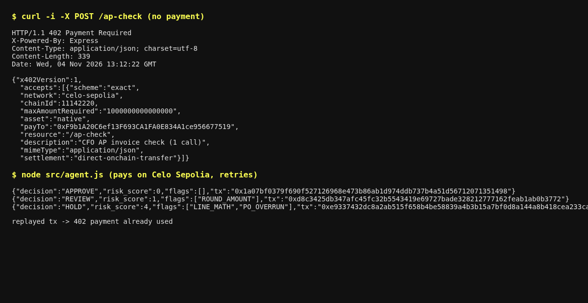
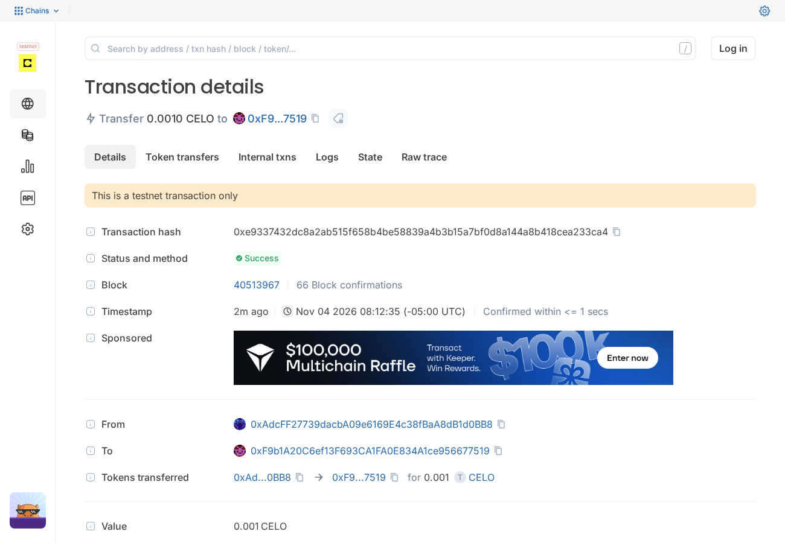

# Open Rails AP-Check: a pay-per-call CFO agent service on Celo (HTTP 402)

An agent-to-agent service: send an invoice as JSON and get back an accounts-payable control decision (**APPROVE / REVIEW / HOLD**) with flags. Each call is paid with an HTTP 402 flow settled on Celo. Built for Celo **Agents on Open Rails**, "Build with `buy`" track. USD₮/Open Corridors is planned and not entered.

Built by Shyam Desigan (CFO, Cubiczan). These are the checks a CFO runs before releasing a payment.

## What it checks
- Line math, subtotal and total reconciliation
- Duplicate invoice (vendor + invoice number)
- Remit-to bank account differs from the vendor master (business-email-compromise signal)
- PO overrun above 5%, high tax rate, large round amounts, due date before the invoice date

## Payment flow
1. `POST /ap-check` without payment returns `402` with x402-style requirements (`scheme: exact`, chainId, asset, `payTo`, amount).
2. The buyer agent (`src/agent.js`) pays on Celo with a native CELO or ERC-20 (USD₮/USDC) transfer. If an `ERC8021_SUFFIX` is set, the attribution suffix is appended to the calldata.
3. The buyer retries with an `X-PAYMENT` header (base64 `{txHash}`). The server reads the receipt from Celo RPC and checks the payee, amount, success, recency and single use. Then it serves the result and returns `X-PAYMENT-RESPONSE`.

Honest scope: settlement is a **direct on-chain transfer verified by the seller**, not the Celo x402 facilitator. Moving to the facilitator (gasless EIP-3009 USD₮) is the next step for the Open Corridors subtrack.

## Run
```bash
npm i && npm test
# testnet (Celo Sepolia, chain 11142220)
NETWORK=sepolia PAY_TO=0xSeller KEY_FILE=~/.celo/buyer.key ./scripts/demo.sh
# mainnet (Celo, chain 42220), USD₮ 0x48065fbBE25f71C9282ddf5e1cD6D6A887483D5e (6 decimals)
NETWORK=mainnet PAY_ASSET=0x48065fbBE25f71C9282ddf5e1cD6D6A887483D5e PAY_DECIMALS=6 PRICE=0.01 \
  ERC8021_SUFFIX=0x... PAY_TO=0xSeller CELO_AGENT_PK=... ./scripts/demo.sh
```
Keys only ever come from an env var or a key file. They are never logged.

## Status (testnet proof only)
- **Done:** unit tests pass. On Celo Sepolia, 3 calls were paid in native CELO, one each for APPROVE, REVIEW and HOLD. Resubmitting a used payment was refused with `402 payment already used`. Hashes are in [`PROOF.md`](PROOF.md).
- **Not done:** mainnet payments, ERC-8004 Agent ID registration, and the ERC-8021 attribution tag. No mainnet transactions exist yet.
- **Planned:** mainnet USD₮ settlement through the Celo x402 facilitator (EIP-3009, gasless). The code is already switchable to mainnet by config (see Run).

## Screenshots
402 challenge, then the paid calls (Celo Sepolia):



HOLD-case payment on the Celo Sepolia explorer:


